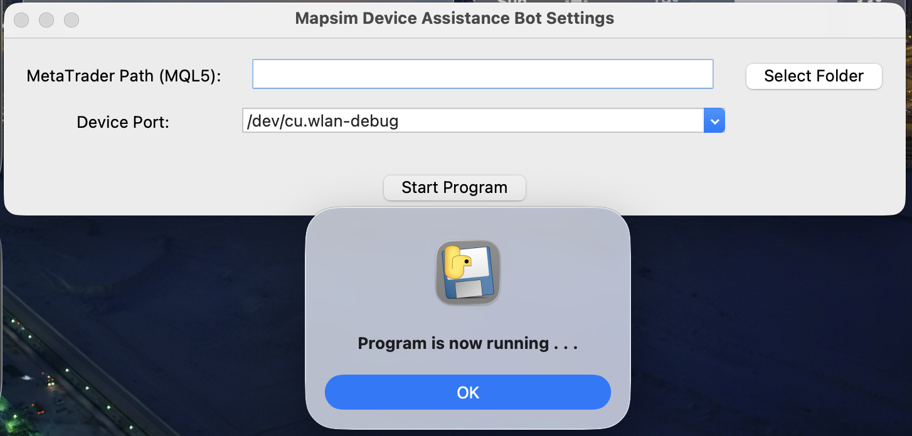
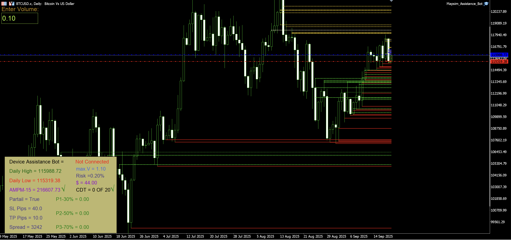

## Mapsim Assistance Bot

> **First time here? Start with [`START_HERE.md`](START_HERE.md)** — the complete
> first-run tutorial (English and Persian): install, buy the serial, activate it,
> run the Expert and open the dashboard.

- Mapsim Assistance Bot is an innovative solution designed to enhance your trading experience in MetaTrader 5. It combines hardware and software to provide seamless and efficient market interactions.

-  This product consists of three main components:

    **Mapsim Device (Hardware)**

    **Mapsim Device Software**

    **Mapsim Assistance Bot Expert** (Expert Advisor for MetaTrader 5)

## Product

- **Mapsim Device** :
  
  <div style="text-align: center;">
    
  </div>

- **Mapsim Device Software** :

  <div style="text-align: center;">
    
  </div>
- **Mapsim Assistance Bot Expert** :

  <div style="text-align: center;">
    
  </div>
  


## Features

1. Mapsim Device
A hardware device that connects to your computer.
Enables direct interaction with MetaTrader 5 through dedicated software.

2. Mapsim Device Software
A companion application that bridges the hardware with MetaTrader 5.
Must be running on your computer to use the Mapsim Device.

3. Mapsim Assistance Bot Expert
An Expert Advisor (EA) for MetaTrader 5.
Helps automate and streamline trading actions using the Mapsim Device.


## Getting started (5 steps)

> **The full walkthrough is [`START_HERE.md`](START_HERE.md)** - English and
> Persian, with a troubleshooting table. This is the same journey in short.

**1. Install the control centre** - one line; it installs the dashboard too:

```powershell
# Windows 10/11 (PowerShell)
irm https://raw.githubusercontent.com/MAPSIM-co/Mapsim_Assistance_Bot/main/Dashboard_Release/install.ps1 | iex
```

```sh
# macOS / Linux
curl -fsSL https://raw.githubusercontent.com/MAPSIM-co/Mapsim_Assistance_Bot/main/Dashboard_Release/install.sh | sh
```

From then on the command `Mapsim_BOT` opens the menu (bilingual: press **L**).

**2. Install the Expert** - in the menu choose `9) Expert Advisor: install /
update`. It finds your MetaTrader 5 folder and copies the Expert, the SQLite
library and the sounds into place. Restart MetaTrader 5, attach the Expert to a
chart and allow DLL imports and algorithmic trading.

**3. Buy the licence** - <https://shop.mapsim.shop> → sign up → top up the wallet
with USDT (TRC20 / ERC20 / BEP20, plus the transaction id) → choose a plan on
`/plans` → the **serial** appears immediately on `/app/licences` (press
*Reveal*).

**4. Activate the serial** - `Mapsim_BOT` → **License** → `4) Activate the Expert
with a serial`. The menu registers your MetaTrader folder, binds the serial to
this machine, and **derives the dashboard login from the same licence**.

**5. Start both** - the Expert shows ACTIVE on the chart; `Mapsim_BOT` → `2) Start
dashboard` opens <http://127.0.0.1:8765>. If the browser asks for a username and
password, use the dashboard login the menu printed (the same value in both
boxes); `License → 1` prints it again at any time.

### Mapsim Device (hardware)

The USB device and its software are a separate download:

* Windows - [Mapsim_Device_Settings_And_Installation_For_Windows7](https://github.com/MAPSIM-co/Mapsim_Device_Settings_And_Installation_For_Windows7)
* macOS - [Mapsim_Device_Settings_And_Installation_For_MACOS](https://github.com/MAPSIM-co/Mapsim_Device_Settings_And_Installation_For_MACOS)

Connect the device and launch its software before starting MetaTrader 5; the
Expert talks to it over USB. Buying and activating the licence does not involve
the device.

---

## How It Works

Connect: Plug in the Mapsim Device and launch the Mapsim Device Software.

Run MetaTrader 5: Open your trading terminal and attach the Mapsim Assistance Bot Expert to your desired chart.

**Interact: Use the hardware device to execute trading actions like Buy, Sell,Partial Position,or Close with precision.**


## Mapsim Live Dashboard (desktop app)

A read-only desktop dashboard for your MetaTrader 5 account. It reads the
snapshot that the Expert Advisor writes and shows positions, recovery state,
market structure, news and the event log in your browser.

> The dashboard **never sends orders** and **never writes** to MetaTrader 5 or
> to the Expert Advisor. It only reads data.

No Python installation is required. Download one file, unpack it and run it.

### One-command install

**macOS and Linux** — paste in Terminal:

```sh
curl -fsSL https://raw.githubusercontent.com/MAPSIM-co/Mapsim_Assistance_Bot/main/Dashboard_Release/install.sh | sh
```

**Windows 10/11 (64-bit)** — paste in PowerShell:

```powershell
irm https://raw.githubusercontent.com/MAPSIM-co/Mapsim_Assistance_Bot/main/Dashboard_Release/install.ps1 | iex
```

The installer detects your system, downloads the latest `dashboard-v*` release,
verifies its SHA-256 checksum, installs it for your user and starts it:

| System | Installed to |
|---|---|
| macOS | `~/Applications/MapsimDashboard.app` |
| Linux | `~/.local/share/MapsimDashboard` (plus `mapsim-dashboard` / `Mapsim_BOT` commands and an app-menu entry) |
| Windows | `%LOCALAPPDATA%\MapsimDashboard` (plus a `Mapsim_BOT` Desktop shortcut) |

### Mapsim BOT control center

After installing, manage everything from one interactive menu — it asks only
when a decision is needed (local or internet, port, license, service) and does
the rest itself:

```sh
Mapsim_BOT          # macOS / Linux: status, start/stop, install/update,
                    # auto-start service, access mode, license, uninstall
```

```powershell
Mapsim_BOT.cmd      # Windows (Desktop shortcut or %LOCALAPPDATA%\MapsimDashboard)
```

The same actions are also available as installer flags (`--public`,
`--service`, `--remove-service`, `--uninstall`) — see
[`Dashboard_Release/README.md`](Dashboard_Release/README.md):

- **One licence for the Expert and the dashboard** — the serial bought on
  <https://shop.mapsim.shop> activates the Expert (`License → 4`, which also
  registers your MetaTrader folder first, otherwise the Expert reports
  `NO_LEASE`), and the menu then **builds the dashboard login from that same
  licence** (`License → 1` shows or refreshes it, `2` shows its status). There is
  no second licence to buy and nothing to type twice; the dashboard's web
  sign-in is that derived login. `5` shows what the Expert sees, `6` registers
  another MetaTrader folder, `7` refreshes the licence now (after a renewal),
  `10` turns the automatic refresh on or off, `11` removes it from this machine.
  The serial decides which product you bought - assistant (every phase-one
  feature except automatic trading) or full - so the menu never asks you to pick
  a model, and the licence Agent is downloaded on first use: `Mapsim_BOT` stays
  the only menu a customer needs.
- **Watch the dashboard from the internet / other devices** — run `Mapsim_BOT`
  and choose **7) Access mode (local / internet)** (or reinstall with
  `--public` / `-Public`): it binds to all network interfaces and asks for the
  license credentials on every request. Plain HTTP, so prefer a trusted network
  or put it behind HTTPS.
- **Start automatically after every reboot** — `Mapsim_BOT` menu 5 opens the
  service submenu (status, install + enable, start, stop, restart, enable or
  disable at boot/login), or reinstall with `--service` / `-Service`: systemd
  on Linux, LaunchAgent on macOS, a scheduled task on Windows. Menu 6 removes
  the service.
- **Stop for real** — menu 3 stops every process of the dashboard (including
  the child that PyInstaller onefile starts), frees the port and also stops the
  auto-start service, so nothing restarts in the background. Logs stay small
  automatically: past 256 KB only the newest lines remain.
- **Install or update the Expert Advisor** — `Mapsim_BOT` menu 9 finds your
  MetaTrader 5 folder, downloads the newest EA release and copies the expert,
  include files, libraries and sounds into place; menu 10 checks for a newer
  version and updates with one key.
- **Check server storage** — `Mapsim_BOT` menu 11 shows every filesystem, the
  dashboard folder sizes and free space. The panel at the top of the menu also
  shows free disk space at all times (green below 75% used, yellow 75–89%,
  red 90% or more).
- **Point the dashboard at your data** — `Mapsim_BOT` menu 12 (macOS/Linux) shows which
  `snapshot.json` the dashboard reads and how old it is. It searches every Wine
  prefix for `MQL5/Files/MapsimLive/snapshot.json`; if your MT5 lives elsewhere,
  type the file, the MQL5 folder or the MT5 folder itself — Windows-style paths
  such as `C:\Program Files\MetaTrader 5` are translated to the right
  `drive_c` folder automatically.
- **Keep the dashboard up to date** — the version is printed in the dashboard
  footer and under the title (`Dashboard Version v1.0.9`). When a newer release is published, the dashboard shows
  a red update banner with the release-notes link, and the menu warns at start.
  Menu 14 on macOS/Linux (13 on Windows) chooses: **notify** (default),
  **auto** (download, checksum-check and install the new release by itself at
  the next menu start) or **off**. Updates never touch MetaTrader 5 or the EA.
- **Leave any option and go back** — inside every menu option, type `0` (or
  `b` / `back` / `q`) at a prompt to return to the main menu without changing
  anything.
- **Remove everything** — `Mapsim_BOT` menu 8 (or `install.sh --uninstall` /
  `install.ps1 -Uninstall`) deletes the app, the auto-start service, the saved
  license and all logs. Nothing touches MetaTrader 5.

### Download (advanced / offline install)

> The one-command install above is the supported path: the control centre also
> builds the dashboard login from your Expert licence, which a bare zip cannot.
> If you unpack a release by hand, run `Mapsim_BOT → License → 1` once before
> starting the dashboard.

Open the [**Releases**](https://github.com/MAPSIM-co/Mapsim_Assistance_Bot/releases/latest)
page and download the build for your system:

| System | File |
|---|---|
| Windows 10/11 (64-bit) | `MapsimDashboard-windows-x64.zip` |
| macOS — Apple Silicon (M1/M2/M3/M4) | `MapsimDashboard-macos-arm64.zip` |
| macOS — Intel | `MapsimDashboard-macos-x64.zip` |
| Linux (64-bit) | `MapsimDashboard-linux-x64.tar.gz` |

Each release also publishes a `.sha256` file next to each archive so you can
verify the download.

### Install on Windows

1. Install the Expert Advisor first (see **Installation and Setup** above) and
   attach it to a chart in MetaTrader 5.
2. Download `MapsimDashboard-windows-x64.zip` and unzip it anywhere you like
   (for example `C:\MapsimDashboard`).
3. Run `MapsimDashboard.exe`.
4. Windows SmartScreen may warn about an unknown publisher the first time.
   Choose **More info → Run anyway**.
5. Your browser opens the dashboard at `http://127.0.0.1:8765/`.

The dashboard detects the default MetaTrader 5 data folder automatically
(`%APPDATA%\MetaQuotes\Terminal\<instance>\MQL5\Files\MapsimLive\snapshot.json`),
including portable installs under `%ProgramFiles%\MetaTrader 5`.

### Install on macOS and Linux

- **macOS** — unzip and open `MapsimDashboard.app`. If macOS blocks it,
  right-click the app and choose **Open**.
- **Linux** — unpack the archive, run `chmod +x MapsimDashboard` once, then
  start it.

### Using the dashboard

- Start the dashboard after MetaTrader 5 and the EA are running. If several MT5
  terminals or snapshots are present, the newest snapshot is used; with several
  terminals, start MT5 first and restart the app if the wrong one was picked.
- To use a specific file instead, start the app from a terminal with
  `--file /path/to/snapshot.json` (or set `MAPSIM_SNAPSHOT`).
- If port `8765` is busy, start with `--port 8799` (or any free port).
- To watch a VPS account, open the **Link** tab in the dashboard and connect
  over SFTP. The password is kept in memory only.
- Logs are written to `dashboard.log` in the per-user application folder
  (`%APPDATA%\MapsimDashboard` on Windows).

Full details, build instructions and troubleshooting: [`Dashboard_Release/README.md`](Dashboard_Release/README.md).

---

## Requirements

- Operating System: Windows 10/11 (64-bit) or macOS 12+ / 64-bit Linux

- Driver Mapsim Device For Windows 32/64 Bit

- Mapsim Device (hardware, optional) — the licence does not depend on it

- Licence serial from <https://shop.mapsim.shop> — one serial covers the Expert
  and the dashboard

- MetaTrader Version: MetaTrader 5 (64-bit)

- Hardware Interface: USB

---
## UPDATE EXPERT

  This Expert Advisor is a highly customizable Forex Trading EA that provides advanced risk management, partial close features,momentum control, and visual feedback on the chart.

- Version V24.0.29 is the current build; `Mapsim_BOT → 9` installs the newest
  release and `10` tells you when a newer one exists.

  ## 🔹 Key Features
  
    - TP/SL Management
    - Set Stop Loss (SL) and Take Profit (TP) in pips
    - Enable or disable automatic SL/TP
    - Risk & Volume Management
    - Default lot/contract size
    - Automatic calculation of allowed trade volume based on account risk
    - Display allowed volume according to your risk settings
    - Partial Close Management
    - Enable/disable partial close for Step 1, Step 2, Step 3
    - Option to use Trial SL with partial steps
    - Configure percentage of volume for each partial step and manual partial
    - Daily Trade Control
    - Limit number of trades per day (MaxDailyTrades)
    - Daily profit limit (MaxDailyProfitUSD)
    - Optional display of trade calculations in the output
    - Momentum Management
    - Market momentum calculation for trade eligibility
    - Trade allowed or blocked based on momentum value
    - Chart Information Display
    - Information Box and Volume Box with customizable size, position, font, and color
    - Daily High & Low lines
    - OB+ / OB- (Order Block) lines with adjustable style, width, and color
    - Delivery price lines (High, Low, Open)
    - Auto Break-Even Mode
    - Automatic close at break-even
    - Spread buffer for safe exit
    - Popup Message Management
    - Error, warning, and daily P/L popup messages
    - Fully customizable box size, position, color, font, sound, and display duration

---

## Support

- Shop, licence panel and renewals: **<https://shop.mapsim.shop>**
- Issues and questions: **[GitHub issues](https://github.com/MAPSIM-co/Mapsim_Assistance_Bot/issues)**
- Telegram: [**@Tarantula_trade**](https://t.me/Tarantula_trade)
- Email: **support@mapsimco.sbs**

## License 

MIT License: [**MIT**](https://raw.githubusercontent.com/MAPSIM-co/Mapsim_Assistance_Bot/main/LICENSE)
