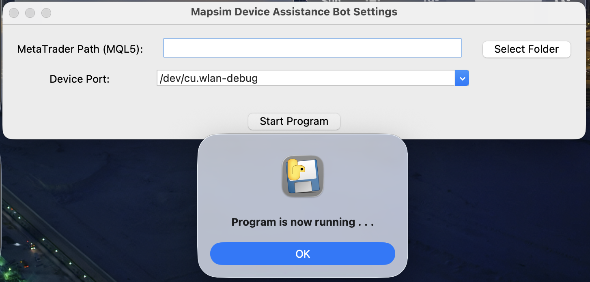
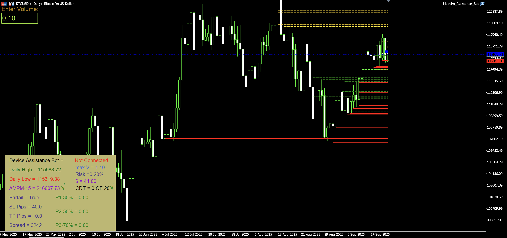

## Mapsim Assistance Bot

- Mapsim Assistance Bot is an innovative solution designed to enhance your trading experience in MetaTrader 5. It combines hardware and software to provide seamless and efficient market interactions.

-  This product consists of three main components:

    **Mapsim Device (Hardware)**

    **Mapsim Device Software**

    **Mapsim Assistance Bot Expert** (Expert Advisor for MetaTrader 5)

## Product

- **Mapsim Device** :
  
  <div style="text-align: center;">
    
  </div>

- **Mapsim Device Software** :

  <div style="text-align: center;">
    
  </div>
- **Mapsim Assistance Bot Expert** :

  <div style="text-align: center;">
    
  </div>
  


## Features

1. Mapsim Device
A hardware device that connects to your computer.
Enables direct interaction with MetaTrader 5 through dedicated software.

2. Mapsim Device Software
A companion application that bridges the hardware with MetaTrader 5.
Must be running on your computer to use the Mapsim Device.

3. Mapsim Assistance Bot Expert
An Expert Advisor (EA) for MetaTrader 5.
Helps automate and streamline trading actions using the Mapsim Device.


## Installation and Setup

**Step 1: Download the Expert Advisor**

Navigate to the File section on this repository.
Download the latest version of the Mapsim Assistance Bot Expert file.

OR

* Download **[Zip File Expert](https://github.com/MAPSIM-co/Mapsim_Assistance_Bot/archive/refs/heads/main.zip)**

---

**Step 2: Install the Expert Advisor**

* Open MetaTrader 5.
* Go to File → Open Data Folder.
* Navigate to :

  **Metatrader5/MQL5** 

Now copy the files from the downloaded package into the correct folders:

* 📂 **Experts** → copy file inside Experts → to → **MQL5/Experts/**

  * ⚠️ Important:(maCOS / Windows Folders)

      **If you are on Windows (32/64 bit) or macOS, make sure to copy the Expert file that matches your operating system into the MQL5/Experts/File.**

* 📂 **Libraries** → copy file inside Libraries → to → **MQL5/Libraries/**
* 📂 **Sounds** → copy **(Mapsim_Assistance_Bot)** folder inside this → to → **MetaTrader 5/Sounds/**

* Restart MetaTrader 5 to load the Expert Advisor.

  * If you Not Install Meta Trader 5 In Your OS , You Can Download Free Meta Trader 5 From **[here](https://www.metatrader5.com/en/download)**

---

**Step 3: Set Up the Mapsim Device Software Setting**

Download and install the Mapsim Device Software Setting from here:

* [From Windows](https://github.com/MAPSIM-co/Mapsim_Device_Settings_And_Installation_For_Windows7)

* [From mcOS](https://github.com/MAPSIM-co/Mapsim_Device_Settings_And_Installation_For_MACOS)


Connect the Mapsim Device to your computer via USB.

* Installation USB Driver For Windows 32 or 64 Bit In The Zip File


Launch the software before starting MetaTrader 5.

---

**Step 4: Get The License Expert**

- Go to [Mapsim Bot](https://telegram.me/Tarantula_trade_chBot?start=5580469558)

* Go to Account Status Menu 

  * Follow Bot Commands 

* Insert Your SERIAL NUMBER in The Your Mapsim Device **(QR Code & Barcod & Text)**

* Add you Account Number from the your Broker

     - (🚨 You Can ONLY Get 2 Licenses Per Device On Your Broker Account Number 🚨)

* Send your Request 

- [Receive Your License] 

- [Insert your License To Expert In MetaTrader 5]

* Activation Mapsim Assistance Bot 

**You Can After Make your License,Go to This Link for watch Active License:**

   [Watch Active Your License ](https://mapsimco.sbs/login.php)

 - You can Entery From Site By Your User Name And Password From Bot

---

## How It Works

Connect: Plug in the Mapsim Device and launch the Mapsim Device Software.

Run MetaTrader 5: Open your trading terminal and attach the Mapsim Assistance Bot Expert to your desired chart.

**Interact: Use the hardware device to execute trading actions like Buy, Sell,Partial Position,or Close with precision.**


## Mapsim Live Dashboard (desktop app)

A read-only desktop dashboard for your MetaTrader 5 account. It reads the
snapshot that the Expert Advisor writes and shows positions, recovery state,
market structure, news and the event log in your browser.

> The dashboard **never sends orders** and **never writes** to MetaTrader 5 or
> to the Expert Advisor. It only reads data.

No Python installation is required. Download one file, unpack it and run it.

### One-command install

**macOS and Linux** — paste in Terminal:

```sh
curl -fsSL https://raw.githubusercontent.com/MAPSIM-co/Mapsim_Assistance_Bot/main/Dashboard_Release/install.sh | sh
```

**Windows 10/11 (64-bit)** — paste in PowerShell:

```powershell
irm https://raw.githubusercontent.com/MAPSIM-co/Mapsim_Assistance_Bot/main/Dashboard_Release/install.ps1 | iex
```

The installer detects your system, downloads the latest `dashboard-v*` release,
verifies its SHA-256 checksum, installs it for your user and starts it:

| System | Installed to |
|---|---|
| macOS | `~/Applications/MapsimDashboard.app` |
| Linux | `~/.local/share/MapsimDashboard` (plus `mapsim-dashboard` / `Mapsim_BOT` commands and an app-menu entry) |
| Windows | `%LOCALAPPDATA%\MapsimDashboard` (plus a `Mapsim_BOT` Desktop shortcut) |

### Mapsim BOT control center

After installing, manage everything from one interactive menu — it asks only
when a decision is needed (local or internet, port, license, service) and does
the rest itself:

```sh
Mapsim_BOT          # macOS / Linux: status, start/stop, install/update,
                    # auto-start service, access mode, license, uninstall
```

```powershell
Mapsim_BOT.cmd      # Windows (Desktop shortcut or %LOCALAPPDATA%\MapsimDashboard)
```

The same actions are also available as installer flags (`--public`,
`--service`, `--remove-service`, `--uninstall`) — see
[`Dashboard_Release/README.md`](Dashboard_Release/README.md):

- **Enter your license (required)** — the dashboard runs on the same license as
  the Expert Advisor. The `Mapsim_BOT` license item (13 on macOS/Linux, 12 on
  Windows) takes the license code, username and password and validates them
  like the EA (active code, expiry, account number from the live snapshot).
  Without a valid license the dashboard does not start, and the web sign-in is
  the license username and password.
- **Watch the dashboard from the internet / other devices** — run `Mapsim_BOT`
  and choose **7) Access mode (local / internet)** (or reinstall with
  `--public` / `-Public`): it binds to all network interfaces and asks for the
  license credentials on every request. Plain HTTP, so prefer a trusted network
  or put it behind HTTPS.
- **Start automatically after every reboot** — `Mapsim_BOT` menu 5 opens the
  service submenu (status, install + enable, start, stop, restart, enable or
  disable at boot/login), or reinstall with `--service` / `-Service`: systemd
  on Linux, LaunchAgent on macOS, a scheduled task on Windows. Menu 6 removes
  the service.
- **Stop for real** — menu 3 stops every process of the dashboard (including
  the child that PyInstaller onefile starts), frees the port and also stops the
  auto-start service, so nothing restarts in the background. Logs stay small
  automatically: past 256 KB only the newest lines remain.
- **Install or update the Expert Advisor** — `Mapsim_BOT` menu 9 finds your
  MetaTrader 5 folder, downloads the newest EA release and copies the expert,
  include files, libraries and sounds into place; menu 10 checks for a newer
  version and updates with one key.
- **Check server storage** — `Mapsim_BOT` menu 11 shows every filesystem, the
  dashboard folder sizes and free space. The panel at the top of the menu also
  shows free disk space at all times (green below 75% used, yellow 75–89%,
  red 90% or more).
- **Point the dashboard at your data** — `Mapsim_BOT` menu 12 (macOS/Linux) shows which
  `snapshot.json` the dashboard reads and how old it is. It searches every Wine
  prefix for `MQL5/Files/MapsimLive/snapshot.json`; if your MT5 lives elsewhere,
  type the file, the MQL5 folder or the MT5 folder itself — Windows-style paths
  such as `C:\Program Files\MetaTrader 5` are translated to the right
  `drive_c` folder automatically.
- **Keep the dashboard up to date** — the version is printed in the dashboard
  footer and under the title (`Dashboard Version v1.0.6`). When a newer release is published, the dashboard shows
  a red update banner with the release-notes link, and the menu warns at start.
  Menu 14 on macOS/Linux (13 on Windows) chooses: **notify** (default),
  **auto** (download, checksum-check and install the new release by itself at
  the next menu start) or **off**. Updates never touch MetaTrader 5 or the EA.
- **Leave any option and go back** — inside every menu option, type `0` (or
  `b` / `back` / `q`) at a prompt to return to the main menu without changing
  anything.
- **Remove everything** — `Mapsim_BOT` menu 8 (or `install.sh --uninstall` /
  `install.ps1 -Uninstall`) deletes the app, the auto-start service, the saved
  license and all logs. Nothing touches MetaTrader 5.

### Download

Open the [**Releases**](https://github.com/MAPSIM-co/Mapsim_Assistance_Bot/releases/latest)
page and download the build for your system:

| System | File |
|---|---|
| Windows 10/11 (64-bit) | `MapsimDashboard-windows-x64.zip` |
| macOS — Apple Silicon (M1/M2/M3/M4) | `MapsimDashboard-macos-arm64.zip` |
| macOS — Intel | `MapsimDashboard-macos-x64.zip` |
| Linux (64-bit) | `MapsimDashboard-linux-x64.tar.gz` |

Each release also publishes a `.sha256` file next to each archive so you can
verify the download.

### Install on Windows

1. Install the Expert Advisor first (see **Installation and Setup** above) and
   attach it to a chart in MetaTrader 5.
2. Download `MapsimDashboard-windows-x64.zip` and unzip it anywhere you like
   (for example `C:\MapsimDashboard`).
3. Run `MapsimDashboard.exe`.
4. Windows SmartScreen may warn about an unknown publisher the first time.
   Choose **More info → Run anyway**.
5. Your browser opens the dashboard at `http://127.0.0.1:8765/`.

The dashboard detects the default MetaTrader 5 data folder automatically
(`%APPDATA%\MetaQuotes\Terminal\<instance>\MQL5\Files\MapsimLive\snapshot.json`),
including portable installs under `%ProgramFiles%\MetaTrader 5`.

### Install on macOS and Linux

- **macOS** — unzip and open `MapsimDashboard.app`. If macOS blocks it,
  right-click the app and choose **Open**.
- **Linux** — unpack the archive, run `chmod +x MapsimDashboard` once, then
  start it.

### Using the dashboard

- Start the dashboard after MetaTrader 5 and the EA are running. If several MT5
  terminals or snapshots are present, the newest snapshot is used; with several
  terminals, start MT5 first and restart the app if the wrong one was picked.
- To use a specific file instead, start the app from a terminal with
  `--file /path/to/snapshot.json` (or set `MAPSIM_SNAPSHOT`).
- If port `8765` is busy, start with `--port 8799` (or any free port).
- To watch a VPS account, open the **Link** tab in the dashboard and connect
  over SFTP. The password is kept in memory only.
- Logs are written to `dashboard.log` in the per-user application folder
  (`%APPDATA%\MapsimDashboard` on Windows).

Full details, build instructions and troubleshooting: [`Dashboard_Release/README.md`](Dashboard_Release/README.md).

---

## Requirements

- Operating System: Windows 32/64 Bit or later And macOS

- Driver Mapsim Device For Windows 32/64 Bit

- Mapsim Device Assistance Bot (213-*) Version

- License Activation Key
  
- MetaTrader Version: MetaTrader 5
  
- Hardware Interface: USB

---
## UPDATE EXPERT

  This Expert Advisor is a highly customizable Forex Trading EA that provides advanced risk management, partial close features,momentum control, and visual feedback on the chart.

- Version V213.1.6 is Run ...

  ## 🔹 Key Features
  
    - TP/SL Management
    - Set Stop Loss (SL) and Take Profit (TP) in pips
    - Enable or disable automatic SL/TP
    - Risk & Volume Management
    - Default lot/contract size
    - Automatic calculation of allowed trade volume based on account risk
    - Display allowed volume according to your risk settings
    - Partial Close Management
    - Enable/disable partial close for Step 1, Step 2, Step 3
    - Option to use Trial SL with partial steps
    - Configure percentage of volume for each partial step and manual partial
    - Daily Trade Control
    - Limit number of trades per day (MaxDailyTrades)
    - Daily profit limit (MaxDailyProfitUSD)
    - Optional display of trade calculations in the output
    - Momentum Management
    - Market momentum calculation for trade eligibility
    - Trade allowed or blocked based on momentum value
    - Chart Information Display
    - Information Box and Volume Box with customizable size, position, font, and color
    - Daily High & Low lines
    - OB+ / OB- (Order Block) lines with adjustable style, width, and color
    - Delivery price lines (High, Low, Open)
    - Auto Break-Even Mode
    - Automatic close at break-even
    - Spread buffer for safe exit
    - Popup Message Management
    - Error, warning, and daily P/L popup messages
    - Fully customizable box size, position, color, font, sound, and display duration

---

## Support

For technical support or inquiries, please contact:

Email: **support@mapsimco.sbs**

Website: **www.mapsimco.sbs**

Telegram: [**Mapsim Bot**](https://telegram.me/Tarantula_trade_chBot?start=5580469558)

## License 

MIT License: [**MIT**](https://raw.githubusercontent.com/MAPSIM-co/Mapsim_Assistance_Bot/main/LICENSE)
